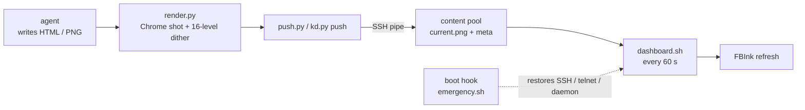

<div align="center">

# kindle-gadget

### Turn a jailbroken Kindle into an agent-driven e-ink dashboard

Any agent writes an HTML file or a PNG; one command puts it on a 7" 300ppi e-ink screen.<br>
Rendering, layout and grayscale dithering happen on the PC. The Kindle only refreshes the display.

[](LICENSE) [](#quick-start) [](docs/opensource/INDEX.md)

**[Quick start](#quick-start)** &nbsp;·&nbsp; **[How it works](#how-it-works)** &nbsp;·&nbsp; **[Features](#features)** &nbsp;·&nbsp; **[Jailbreak guide](docs/opensource/JAILBREAK.en.md)** &nbsp;·&nbsp; **[中文](README.md)**

<br>

<picture>
  <source media="(prefers-color-scheme: dark)" srcset="docs/images/studio-dark.png">
  
</picture>

</div>

<br>

## Who it's for

You have a Kindle gathering dust and want it on your desk showing the schedule, task progress or AI usage your agents put together. kindle-gadget turns that into one command:

- Agents only write HTML. They don't need to know about FBInk, waveforms or the framebuffer.
- CJK text and complex layouts render in Chrome on the PC, so the device needs no fonts.
- Everything runs over Wi-Fi, plugged in and always on. After a reboot the channels and the dashboard come back on their own.

You need a Kindle that can be jailbroken, and you need to accept the risks of jailbreaking. It has only been verified on a Kindle Oasis 3 (firmware 5.18.2) with a Windows PC; other models and host systems have to be re-checked against the docs.

## Quick start

Requirements: a jailbreakable Kindle and a Windows PC (Git Bash, Python 3.10+, Pillow, Chrome or Edge) on the same Wi-Fi.

**1. Jailbreak.** Follow [JAILBREAK.en.md](docs/opensource/JAILBREAK.en.md) to identify your model and firmware, then get root with SpiderCat.

**2. Open the channels.** Follow [SETUP.en.md](docs/opensource/SETUP.en.md) to set up SSH (the dropbear bundled with KOReader, port 2222, key-only) and the FBInk render chain. Every step has a verification command. Point the scripts at your device:

```bash
export KINDLE_HOST=192.168.1.189
```

**3. Push your first card.**

```bash
python push.py cards/hello.html                          # portrait, GC16 full refresh
python push.py cards/hello.html --partial                # partial refresh, no black flash
python push.py cards/desk.html --orientation landscape   # landscape 1680×1264
```

**4. Resident dashboard and autostart (optional).**

```bash
python daemon/kd.py start      # deploy and start the dashboard daemon (idempotent)
cd autostart && ./deploy.sh    # deploy the boot hook
```

The agent-facing contract is in [push.md](push.md) (Chinese): if it can produce HTML or a PNG, it can run `python push.py <file>`.

## How it works



On the PC, headless Chrome captures the HTML at 1264×1680 (1680×1264 in landscape), and Pillow converts it to 16-level grayscale with Floyd–Steinberg dithering. The device has no scp or sftp, so the PNG goes through a `cat | ssh` pipe, lands atomically in the content pool, and is drawn once right away. The daemon on the device checks the pool every 60 seconds and redraws it in the orientation stored in meta, so the picture persists. Only the userstore is ever written; rootfs is never touched.

## Features

### One command to the screen

`push.py` takes HTML or PNG: HTML is rendered first, a PNG with the wrong size is scaled and padded. The default is a GC16 full refresh; `--partial` uses GL16 to avoid the black flash; `--no-refresh` only writes the pool and lets the daemon pick it up next round. Below is real output from the render chain, exactly what the screen shows.

<table>
  <tr>
    <td width="50%" valign="top"></td>
    <td width="50%" valign="top"></td>
  </tr>
</table>

The card text is Chinese because the bundled examples are; any language your system fonts cover will render.

### Resident dashboard

On the device, a busybox ash loop keeps the screen awake while plugged in, polls every 60 seconds, uses GL16 partial refreshes and a GC16 full refresh every 6 rounds to clear ghosting, and re-reads its config each round. `kd.py` drives it from the PC:

```bash
python daemon/kd.py status              # process, config, battery, log
python daemon/kd.py push out/xxx.png    # atomic push, drawn next round
python daemon/kd.py push out/xxx.png --full
```

### Autostart

Uses SpiderCat's official `/mnt/us/emergency.sh` hook: after boot it restores telnetd, dropbear and the iptables rules, and starts the dashboard daemon through `hooks.d`, without writing rootfs. Verified with two real reboots. `./deploy.sh --check`, `--smoke` and `--status` run a syntax check, a one-off smoke run and a status report.

### Studio workbench

`python studio/server.py` serves a local web app on `127.0.0.1:8762` (localhost only): edit card HTML, preview the true render.py output inside an Oasis device frame in portrait or landscape, keep automatic card version history, switch light and dark themes, and push to the Kindle in one click. Annotate mode lets you draw boxes on the preview and send them with your change request to a local agent. `python studio/tray.py` adds a system tray icon that switches the Kindle between normal mode and dashboard mode (needs `pip install pystray`). The Studio UI is in Chinese.

### Usage card

`usage_card.py` reads your local AI CLI usage through `npx ccusage` (today, this week, this month, the current 5-hour window, per-CLI breakdown) and generates a card. Without data it falls back to built-in sample data and marks the card DEMO.

```bash
python usage_card.py -o cards/usage.html --orientation landscape
python push.py cards/usage.html --orientation landscape
```

## Verified scope

- Exactly one test device: Kindle Oasis 3 (10th gen), firmware 5.18.2, SpiderCat jb.sh v2.2.1, Windows 11 with Git Bash, Python 3.14.
- render.py hardcodes the Windows paths of Chrome and Edge; macOS and Linux hosts need an edit.
- Battery mode (suspend plus RTC wake) failed on real hardware and needed a long-press reboot. Don't use it.
- The full verified / unverified / known-broken list is in [INDEX.md](docs/opensource/INDEX.md).

## Docs

| Doc | Contents |
|---|---|
| [JAILBREAK.en.md](docs/opensource/JAILBREAK.en.md) | Jailbreak: model and firmware ID, method matrix, full SpiderCat walkthrough, red lines, pitfall log |
| [SETUP.en.md](docs/opensource/SETUP.en.md) | Post-jailbreak setup: SSH and telnet, KOReader, render chain, daemon, autostart, Studio |
| [INDEX.md](docs/opensource/INDEX.md) | Navigation and verification lists |
| [push.md](push.md) | Agent-facing push.py contract (Chinese) |
| [AGENTS.md](AGENTS.md) | Authoritative device facts and pitfalls (Chinese) |

## License

MIT, see [LICENSE](LICENSE). Studio bundles CodeMirror (MIT) and the Inter font (OFL); FBInk, KOReader and SpiderCat belong to their respective authors. The repository contains no real serial numbers, MAC addresses or keys; the device IP is an example value.

Jailbreaking is an unofficial modification with brick and warranty risks; you proceed at your own risk. This project is not affiliated with Amazon.
