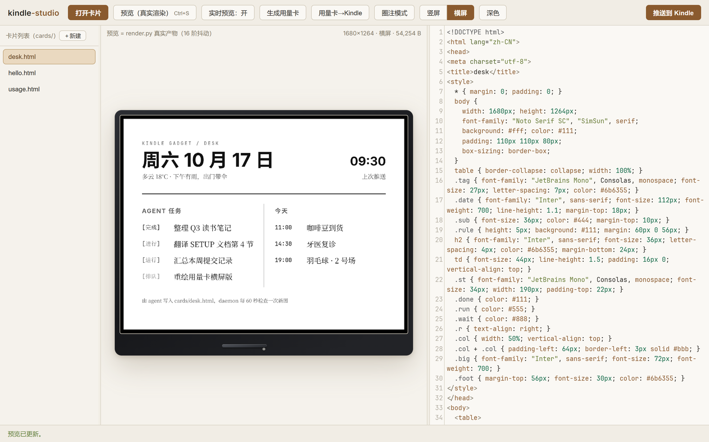
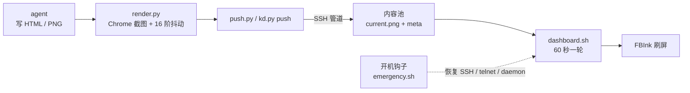
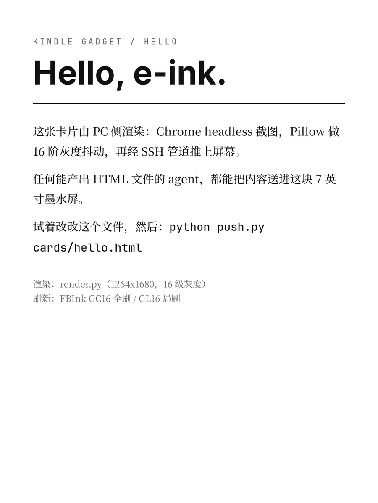
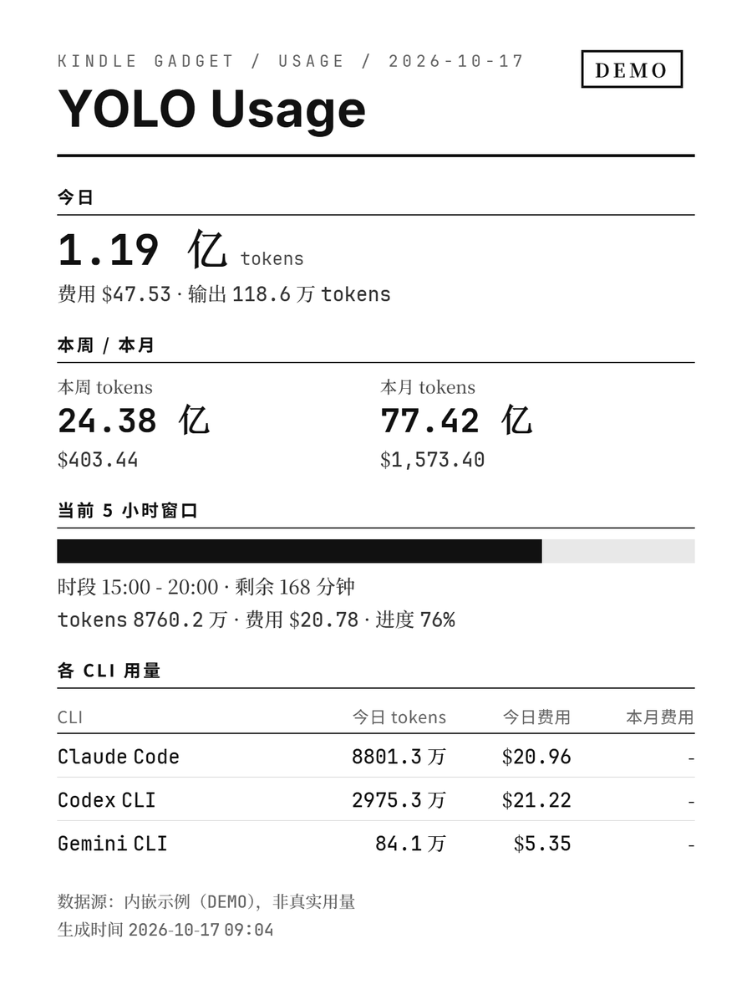

<div align="center">

# kindle-gadget

### 把越狱 Kindle 变成 agent 推送的墨水屏看板

任意 agent 产出一段 HTML 或一张 PNG，一条命令推上 7 英寸 300ppi 墨水屏。<br>
渲染、排版和灰度抖动都在电脑上完成，Kindle 只负责刷屏。

[](LICENSE) [](#快速开始) [](docs/opensource/INDEX.md)

**[快速开始](#快速开始)** &nbsp;·&nbsp; **[怎么运作](#怎么运作)** &nbsp;·&nbsp; **[功能](#功能)** &nbsp;·&nbsp; **[越狱教程](docs/opensource/JAILBREAK.zh.md)** &nbsp;·&nbsp; **[English](README.en.md)**

<br>

<picture>
  <source media="(prefers-color-scheme: dark)" srcset="docs/images/studio-dark.png">
  
</picture>

</div>

<br>

## 适合谁

你手上有一台吃灰的 Kindle，想让它常驻桌面，显示 agent 帮你整理的日程、任务进度或 AI 用量。kindle-gadget 把这条链路做成了一条命令：

- agent 只管写 HTML，不用懂 FBInk、波形和帧缓冲。
- 中文和复杂排版在电脑上用 Chrome 渲染，设备上不需要装字体。
- 全程走 Wi-Fi，插电常驻，重启后通道和看板自动恢复。

前提是 Kindle 能越狱，并且你接受越狱的风险。目前只在 Kindle Oasis 3（固件 5.18.2）加 Windows 电脑上实测过，其他机型和系统需要自己按文档重新判定。

## 快速开始

需要：一台能越狱的 Kindle、一台 Windows 电脑（Git Bash、Python 3.10+、Pillow、Chrome 或 Edge），两者连同一个 Wi-Fi。

**1. 越狱。** 按 [JAILBREAK.zh.md](docs/opensource/JAILBREAK.zh.md) 判定机型和固件，用 SpiderCat 拿到 root。

**2. 打通通道。** 按 [SETUP.zh.md](docs/opensource/SETUP.zh.md) 配好 SSH（KOReader 自带的 dropbear，端口 2222，仅密钥）和 FBInk 渲染链，每一步都有验证命令。设备 IP 用环境变量指定：

```bash
export KINDLE_HOST=192.168.1.189
```

**3. 推第一张卡。**

```bash
python push.py cards/hello.html                          # 竖屏，GC16 全刷
python push.py cards/hello.html --partial                # 局部刷新，无黑闪
python push.py cards/desk.html --orientation landscape   # 横屏 1680×1264
```

**4. 常驻看板和开机自启（可选）。**

```bash
python daemon/kd.py start      # 部署并启动看板 daemon（幂等）
cd autostart && ./deploy.sh    # 部署开机自启钩子
```

给 agent 的调用约定见 [push.md](push.md)：能产出 HTML 或 PNG，就能跑 `python push.py <file>` 上屏。

## 怎么运作



电脑侧把 HTML 用 Chrome headless 截成 1264×1680（横屏 1680×1264），再用 Pillow 转成 16 阶灰度并做 Floyd–Steinberg 抖动。设备上没有 scp 和 sftp，PNG 经 `cat | ssh` 管道原子写进内容池，立即刷一次屏。设备侧的 daemon 每 60 秒检查内容池，按 meta 里的方向重画，保证画面持久。整个过程只写 userstore，不碰 rootfs。

## 功能

### 一条命令上屏

`push.py` 接受 HTML 或 PNG：HTML 先渲染，PNG 尺寸不对就等比缩放补白。默认 GC16 全刷，`--partial` 用 GL16 局刷避免黑闪，`--no-refresh` 只写内容池等 daemon 下一轮刷出。下面是渲染链的真实产物，也就是屏幕上显示的样子。

<table>
  <tr>
    <td width="50%" valign="top"></td>
    <td width="50%" valign="top"></td>
  </tr>
</table>

### 常驻看板

设备侧是一个 busybox ash 常驻循环：插电时禁止休眠，60 秒轮询一次，平时 GL16 局刷，每 6 轮 GC16 全刷清残影，配置每轮重读。电脑侧用 `kd.py` 控制：

```bash
python daemon/kd.py status              # 进程、配置、电量、日志
python daemon/kd.py push out/xxx.png    # 原子推送，下一轮刷出
python daemon/kd.py push out/xxx.png --full
```

### 开机自启

走 SpiderCat 官方的 `/mnt/us/emergency.sh` 钩子：开机后自动恢复 telnetd、dropbear、iptables 规则，并经 `hooks.d` 拉起看板 daemon，不写 rootfs。已在真机重启两次验证。`./deploy.sh --check`、`--smoke`、`--status` 分别做语法检查、单次冒烟和状态查看。

### Studio 工作台

`python studio/server.py` 在 `127.0.0.1:8762` 起一个本地网页（只绑本机）：编辑卡片 HTML，预览 render.py 的真实产物（带 Oasis 设备壳，横竖屏可切），卡片自动存历史版本，深浅主题，一键推到 Kindle。圈注模式可以在预览图上框出要改的区域，连同修改要求发给本地 agent 处理。`python studio/tray.py` 额外常驻系统托盘，可一键切换 Kindle 的正常模式和看板模式（需要 `pip install pystray`）。

### 用量卡

`usage_card.py` 通过 `npx ccusage` 读取本机 AI CLI 用量（今日、本周、本月、当前 5 小时窗口、各 CLI 明细），生成卡片 HTML。没有数据时自动用内嵌示例，并在卡面标 DEMO。

```bash
python usage_card.py -o cards/usage.html --orientation landscape
python push.py cards/usage.html --orientation landscape
```

## 验证范围

- 实测设备只有一台：Kindle Oasis 3（第 10 代）、固件 5.18.2、SpiderCat jb.sh v2.2.1、Windows 11 加 Git Bash、Python 3.14。
- render.py 的浏览器路径写死为 Windows 的 Chrome 和 Edge，macOS 和 Linux 需要自己改。
- battery 模式（挂起加 RTC 唤醒）实测失败，设备只能长按重启，不要用。
- 已验证、未验证和实测失败的完整清单见 [INDEX.md](docs/opensource/INDEX.md)。

## 文档

| 文档 | 内容 |
|---|---|
| [JAILBREAK.zh.md](docs/opensource/JAILBREAK.zh.md) | 越狱：机型和固件判定、方案选型、SpiderCat 全步骤、红线、踩坑实录 |
| [SETUP.zh.md](docs/opensource/SETUP.zh.md) | 越狱后配置：SSH 和 telnet、KOReader、渲染链、daemon、自启、Studio |
| [INDEX.md](docs/opensource/INDEX.md) | 文档导航和验证清单 |
| [push.md](push.md) | 给 agent 的 push.py 调用约定 |
| [AGENTS.md](AGENTS.md) | 设备事实和坑的权威记录 |

## 许可证

MIT，见 [LICENSE](LICENSE)。Studio 内置 CodeMirror（MIT）和 Inter 字体（OFL）；FBInk、KOReader、SpiderCat 归各自作者所有。仓库不含真实序列号、MAC 地址或密钥，设备 IP 是示例值。

越狱是非官方修改，有变砖和失去保修的风险，请自行承担。本项目与 Amazon 无关。
